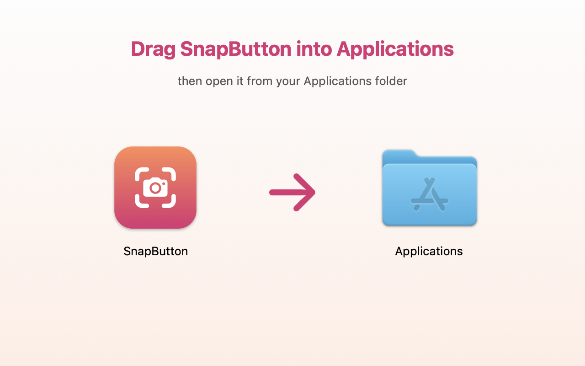

<p align="center">
  
</p>

<h1 align="center">SnapButton</h1>

<p align="center">
  <b>A screenshot button for your Mac's menu bar.</b><br>
  No more pressing ⌘ + Shift + 5. Just click the camera. 📸
</p>

---

## What does it do?

SnapButton puts a little **camera icon** at the top of your screen, right next to your Wi-Fi and battery.

```
                     📷  ᯤ  🔋  Tue 9:41
                     ↑
               click this!
```

- **Click it** → Apple's screenshot bar pops up (the same one you get with ⌘ + Shift + 5). Pick what to capture and you're done.
- **Right-click it** → a small menu with shortcuts:
  - **Capture Part of Screen** — drag a box around what you want
  - **Capture a Window** — click on any window
  - **Capture Whole Screen** — snaps everything instantly
  - **Open Screenshots Folder** — see your screenshots
  - **Start When Mac Turns On** — tick/untick (it's on by default)

Your screenshots save to the **same place as always** (usually your Desktop).

---

## Install it (the easy way) — 1 minute ⏱️

You'll paste **one line** into an app called Terminal. Don't worry, it's safe and you can't break anything.

**Step 1.** Open **Terminal**
Press **⌘ Command + Space**, type **Terminal**, and press **Return**.
A window with text will open. That's it.

**Step 2.** Copy this line (click the copy button on the right side of the box 👉)

```bash
curl -fsSL https://raw.githubusercontent.com/nanadotam/snapbutton/main/install.sh | bash
```

**Step 3.** Paste it into Terminal with **⌘ Command + V**, then press **Return**.

**Step 4.** Wait a few seconds until you see:

```
✅ Done! Look for the camera icon at the top of your screen, next to the Wi-Fi.
```

🎉 **That's it!** Look at the top-right of your screen. You can close Terminal now.

---

## Install it (the drag-and-drop way)

Prefer not to use Terminal? That works too, there's just one extra step at the end.

1. Download **[SnapButton.dmg](https://github.com/nanadotam/snapbutton/releases/latest/download/SnapButton.dmg)**
2. Open it, then **drag the camera icon onto the Applications folder**.

   

3. Open your **Applications** folder and double-click **SnapButton**.

### 😬 "Apple could not verify SnapButton…" — what now?

Apple shows this for any app that wasn't bought from the App Store or paid for an Apple certificate. **SnapButton is safe.** Here's how to let it open:

**Option A: through Settings (no Terminal needed)**

1. Click **Done** on the warning (do **not** click "Move to Trash").
2. Open  **Apple menu → System Settings → Privacy & Security**.
3. Scroll all the way down. You'll see *"SnapButton was blocked…"*. Click **Open Anyway**.
4. Type your Mac password (or use Touch ID), then click **Open Anyway** one more time.

You only have to do this **once**.

**Option B: one line in Terminal**

Open Terminal (⌘ + Space → type *Terminal* → Return), paste this, and press Return:

```bash
xattr -dr com.apple.quarantine /Applications/SnapButton.app && open /Applications/SnapButton.app
```

---

## The first time you use "Capture Part / Window / Whole Screen"

Your Mac may ask: *"SnapButton would like to record this computer's screen."*

Click **Open System Settings**, turn **SnapButton** on, and you're good. (Taking screenshots counts as "recording the screen" to Apple.)

> 💡 Just *clicking* the camera (the screenshot bar) never needs this permission.

---

## Help! 🆘

| Problem | Fix |
|---|---|
| I can't see the camera icon | Your menu bar might be full. Close a few apps, or hold **⌘ Command** and drag other icons out of the way. On a MacBook with a notch, icons can hide behind it. |
| The menu shortcuts do nothing | Turn SnapButton on in **System Settings → Privacy & Security → Screen & System Audio Recording**, then quit and reopen it. |
| I want it gone | Right-click the camera → **Quit SnapButton**, then drag it from Applications to the Trash. Or paste this in Terminal: `curl -fsSL https://raw.githubusercontent.com/nanadotam/snapbutton/main/uninstall.sh \| bash` |
| I want to update it | Just run the install line again. |

---

<details>
<summary>For nerds 🤓</summary>

Tiny native Swift/AppKit app (~150 KB, universal Apple Silicon + Intel, macOS 13+). Left-click opens `/System/Applications/Utilities/Screenshot.app`; menu items call `/usr/sbin/screencapture` and save to your `com.apple.screencapture location` (or Desktop). Launch-at-login via `SMAppService`. Ad-hoc signed, not notarized — hence the Gatekeeper dance.

Build it yourself: `./build.sh` → `dist/SnapButton.dmg` (needs `brew install create-dmg`).

</details>

<p align="center">Made with ❤️ by <a href="https://nanaamoako.com">Nana</a></p>
